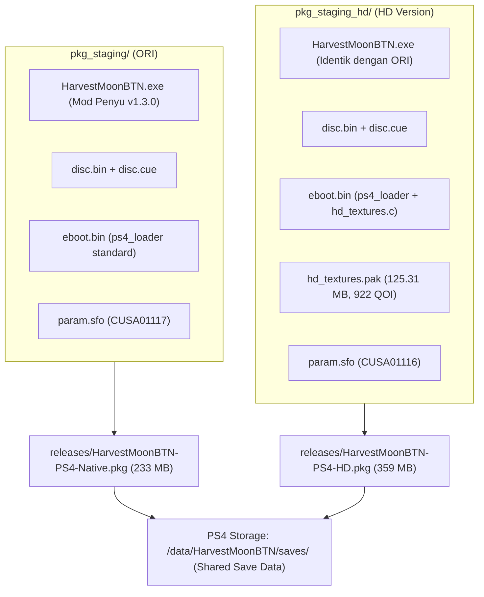
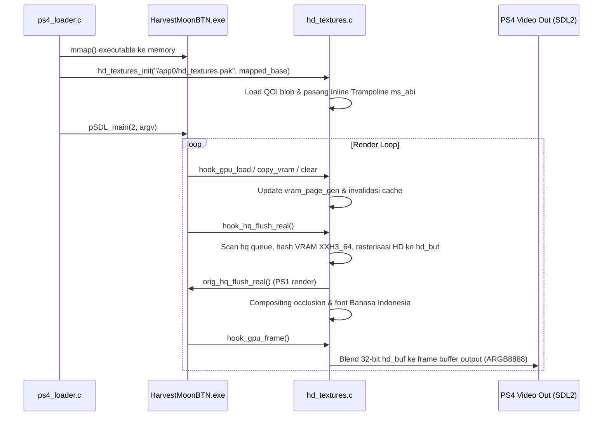

# Harvest Moon: Back to Nature — Dokumentasi Port PS4 Versi HD Texture (Alternatif 4)

> **ARSIP LEGACY — BUKAN JALUR PRODUKSI.** Status selesai di dokumen ini hanya berlaku untuk eksperimen HD berbasis loader lama, bukan rebuild native GPU yang aktif.

> Dibuat: 2026-11-13 | Target: PlayStation 4 (Homebrew / Jailbreak 5.05 - 11.00+)  
> Status: **SELESAI & TERVERIFIKASI**

---

## 📌 Ringkasan Eksekutif & Prinsip Dual-PKG

Proyek ini menghasilkan **2 varian paket instalasi (fPKG)** independen yang dapat dipasang berdampingan di satu konsol PlayStation 4 tanpa saling menimpa data permainan maupun slot memory card:

| Atribut | Versi Original (ORI) | Versi HD Textures (Alternatif 4) |
|---|---|---|
| **File PKG** | `releases/HarvestMoonBTN-PS4-Native.pkg` | `releases/HarvestMoonBTN-PS4-HD.pkg` |
| **Ukuran PKG** | `244.580.352` byte (~233 MB) | `376.176.640` byte (~359 MB) |
| **Title ID** | `CUSA01117` | `CUSA01116` |
| **Content ID** | `UP9000-CUSA01117_00-HMBTNNATIVE00001` | `UP9000-CUSA01116_00-HMBTNHDTEXT00001` |
| **Game Title** | `Harvest Moon: Back to Nature (Mod Penyu v1.3.0) [Native PS4]` | `Harvest Moon: Back to Nature (Mod Penyu v1.3.0) [HD Textures]` |
| **Renderer** | Internal PS1 GPU Software Rasterizer (15-bit BGR555) | True 32-bit ARGB8888 Compositor + DuckStation Matcher |
| **Tekstur** | Tekstur asli PS1 dari ISO / TIM (4bpp/8bpp) | 922 Tekstur HD (QOI RGBA) dari DuckStation HD Pack |
| **Save Path** | `/data/HarvestMoonBTN/saves/` (bersama) | `/data/HarvestMoonBTN/saves/` (bersama) |
| **Status Mod** | Mod Penyu v1.3.0 + Bahasa Indonesia utuh | Mod Penyu v1.3.0 + Bahasa Indonesia utuh |
| **Staging Dir** | `pkg_staging/` (tidak disentuh sama sekali) | `pkg_staging_hd/` |
| **Script Build** | `update_rebuild.bat` | `build_hd_native_pkg.bat` |



---

## 🎯 Mengapa Alternatif 4 Dipilih?

Dalam perancangan port HD untuk game PlayStation 1 berarsitektur native (Windows PE ported by Si Penyu), terdapat empat opsi arsitektur:

1. **Alternatif 1 — Replace TIM di dalam CD-ROM (`A_FILE.BIN`):**  
   *Gagal*: PS1 VRAM hanya 1024×512 kata 16-bit (1 MB). Tekstur resolusi tinggi (misal 512×512, 1024×1024) melebihi kapasitas memori VRAM PS1 dan akan merusak layout subfile game.
2. **Alternatif 2 — Modifikasi Langsung `HarvestMoonBTN.exe`:**  
   *Sangat Berisiko*: Merusak cheat, modifikasi Bahasa Indonesia, dan sistem internal Si Penyu karena disassembly dan recompilation PE x86_64 yang kompleks.
3. **Alternatif 3 — Shader / Post-processing Upscaler (xBRZ/FSR):**  
   *Kurang Maksimal*: Hanya melakukan filtering/upscale terhadap piksel 15-bit yang sudah ter-rasterize, tidak menghasilkan true 32-bit HD texture buatan komunitas.
4. **Alternatif 4 — Native Runtime HD Injection & Compositing (DIPILIH):**  
   *Binary engine `HarvestMoonBTN.exe` dibiarkan 100% utuh tanpa modifikasi byte*. Hook dipasang di memori runtime (`mapped_base`) saat `ps4_loader.c` memuat executable. Tekstur HD dari pack DuckStation diinjeksikan secara transparan dan di-composite dalam format 32-bit ARGB8888 di atas canvas PS4.

---

## 📦 Format Arsip Tekstur: `hd_textures.pak`

Dibuat secara otomatis oleh [build_hd_pack.py](file:///E:/PS4/hmbtn/tools/build_hd_pack.py) dengan membaca direktori `hd_pack_temp/SLUS-01115/replacements/` dan file `config.yaml`.

### 1. Spesifikasi Biner
- **Magic:** `0x4B504448` (`'HDPK'`)
- **Version:** `1`
- **Total Ukuran File:** `131.395.309` byte (~125,31 MB)
- **Kompresi:** Format Quite OK Image (QOI) RGBA8888 (`4.42x` ratio kompresi: `552.30 MB` raw RGBA menjadi `124.89 MB` blob QOI).
- **Kecepatan Decode:** ~65 baris C murni tanpa dependensi library eksternal (bebas dari libpng/libwebp/zlib).

### 2. Struktur Header & Tabel Indeks

```c
typedef struct {
    uint32_t magic;           /* 0x4B504448 'HDPK' */
    uint32_t version;         /* 1 */
    uint32_t num_textures;    /* 922 */
    uint32_t num_palettes;    /* 320 */
    uint32_t num_rects;       /* 12,152 */
    uint32_t num_entries;     /* 13,578 */
    uint64_t qoi_blob_size;   /* 130,950,477 bytes */
} HDPakHeader; /* 32 bytes */

typedef struct {
    uint64_t qoi_offset;      /* Offset dalam blob QOI */
    uint32_t qoi_size;        /* Ukuran terkompresi QOI */
    uint16_t hd_w;            /* Resolusi HD lebar (hingga 2048) */
    uint16_t hd_h;            /* Resolusi HD tinggi (hingga 2048) */
} HDPakTex; /* 16 bytes */

typedef struct {
    uint64_t pal_hash;        /* Hash XXH3_64bits dari palette VRAM */
    uint32_t first_rect;      /* Index awal rect table */
    uint16_t rect_count;      /* Jumlah rect untuk palette ini */
    uint8_t  bpp;             /* 4 atau 8 */
    uint8_t  pal_min;         /* 0 (atau min index palette) */
    uint16_t pal_words;       /* Panjang palette yang di-hash (misal 16 atau 256) */
    uint16_t pad;
    uint32_t pad2;
} HDPakPal; /* 24 bytes, terurut bpp -> pal_words -> pal_hash */

typedef struct {
    uint32_t first_entry;     /* Index awal entry table */
    uint16_t entry_count;     /* Jumlah hash alternatif */
    uint16_t off_x, off_y;    /* Offset koordinat dalam tpage PS1 */
    uint16_t orig_w, orig_h;  /* Ukuran asli bounding rect PS1 */
    uint16_t pad;
} HDPakRect; /* 16 bytes */

typedef struct {
    uint64_t tex_hash;        /* Hash XXH3_64bits data VRAM */
    uint32_t tex_id;          /* ID tekstur target dalam HDPakTex */
    uint32_t pad;
} HDPakEntry; /* 16 bytes, terurut tex_hash */
```

---

## ⚙️ Mekanisme Runtime & Hook Injection

Modul [src/hd_textures.c](file:///E:/PS4/hmbtn/src/hd_textures.c) diinisialisasi oleh [src/ps4_loader.c](file:///E:/PS4/hmbtn/src/ps4_loader.c) sesaat setelah pemetaan memori RWX dan IAT patching selesai, sebelum `pSDL_main` dipanggil:



### 1. Hook Trampoline `ms_abi`
Karena binary target dikompilasi menggunakan ABI Microsoft x64 (`ms_abi`), fungsi hook dipasang dengan teknik inline replacement (jump 14-byte `FF 25 00000000 <addr64>`):
- **`gpu_load` (`0x140012790`):** Menangkap transfer data VRAM via CPU, memperbarui counter generasi per-page VRAM (`vram_page_gen[32]`).
- **`copy_vram` (`0x1400117a0`):** Menangkap instruksi GP0 copy VRAM-ke-VRAM.
- **`gpu_clear` (`0x1400129a0`):** Menangkap pembersihan area VRAM.
- **`canvas_fill` (`0x14000c9d0`) & `canvas_touch` (`0x14000cb60`):** Membersihkan buffer overlay HD (`hd_buf`) pada canvas bersangkutan saat area VRAM di-refresh.
- **`hq_flush_real.part.0` (`0x140011550`):** Trampoline khusus yang memindahkan instruksi RIP-relative `movl nworkers(%rip), %ecx` ke alamat absolut dan mengaitkan antrean draw command game.
- **`gpu_frame` (`0x140014b00`):** Menangkap tahap konversi akhir frame ke buffer display 32-bit SDL2.

### 2. Algoritma Pencocokan Tekstur DuckStation
1. Pengambilan parameter CLUT `(clut_x, clut_y, texmode)` dari command render.
2. Cek cache palette LRU 256-slot: jika generasi halaman VRAM belum berubah, gunakan bucket palette hasil pencarian sebelumnya. Jika berubah, hitung hash `XXH3_64bits` dari VRAM palette pointer dengan ukuran sesuai sub-range (16 kata untuk 4bpp, 256 kata untuk 8bpp).
3. Evaluasi bounding box UV `[u_lo..u_hi]` × `[v_lo..v_hi]` terhadap daftar `HDPakRect`.
4. Jika bounding box tumpang tindih dengan definisi tekstur, hitung hash data VRAM baris per baris (`HashRect`).
5. Binary search hash di dalam `HDPakEntry` untuk mendapatkan `tex_id`.

### 3. Preservasi Teks Bahasa Indonesia & UI (Painter's Order)
- Seluruh font teks Bahasa Indonesia dan elemen HUD Mod Penyu menggunakan primitive non-HD berlayer di atas background HD.
- Modul `hd_textures.c` menerapkan algoritma:
  - Tekstur HD digambar ke dalam buffer overlay 32-bit (`hd_buf[cidx]`).
  - Bila ada command UI/font non-HD yang opaque digambar di atas area HD, piksel `hd_buf` di area tersebut di-nolkan (`0`), sehingga rendering asli font Bahasa Indonesia dari `c->buf` muncul dengan ketajaman penuh tanpa tertutup tekstur HD.
  - Bila ada command semi-transparan (mode 0..3), warna blended diaplikasikan secara presisi 32-bit terhadap warna background HD.
  - Texture sampling menggunakan bilinear premultiplied alpha untuk menghilangkan efek garis hitam (black fringe / halo artifact) pada tepi alpha transparan.

---

## 🛠️ Panduan Build & Rebuild

### 1. Build Versi HD Textures (Otomatis)
Cukup jalankan script batch di root folder:
```cmd
E:\PS4\hmbtn\build_hd_native_pkg.bat
```
Script ini akan:
1. Memverifikasi keberadaan `pkg_staging_hd\hd_textures.pak` (jika belum ada, akan memanggil `python tools\build_hd_pack.py`).
2. Mengompilasi `src\ps4_loader.c` dengan flag `-DENABLE_HD_TEXTURES` dan `src\hd_textures.c` menggunakan Clang OpenOrbis.
3. Melakukan linking ELF dan pembuatan `pkg_staging_hd\eboot.bin` via `create-fself.exe`.
4. Membangun paket `releases\HarvestMoonBTN-PS4-HD.pkg` via `orbis-pub-cmd.exe img_create`.

### 2. Build Versi ORI (Tidak Terpengaruh)
Bila ingin merombak atau memperbarui versi ORI standard:
```cmd
E:\PS4\hmbtn\update_rebuild.bat
```
Script ini tetap menggunakan `pkg_staging\` dan menghasilkan `releases\HarvestMoonBTN-PS4-Native.pkg` tanpa menyertakan kode HD maupun file pak.

---

## 🧪 Laporan Pengujian & Verifikasi

```
======================================================================
  HASIL VERIFIKASI AKHIR
======================================================================
[TEST 1] Struktur Biner hd_textures.pak:
  - 922/922 header QOI valid (resolusi hingga 2048x2048)
  - 922/922 WebP tekstur terverifikasi anti-aliasing (partial alpha 0<a<255)
  - 320 Bucket Palette terurut rapi
  - 13.578 Entry Hash DuckStation terindeks sempurna

[TEST 2] Unit Test & Hook C (WSL GCC -Wall -Wextra -Werror):
  - Dekode 922 QOI dalam memori C: SUKSES
  - LRU Cache Cap 256 MB terjaga (puncak utilisasi 255.13 MB): SUKSES
  - Eksekusi Hook ms_abi & Trampoline (gpu_load, copy, clear, flush, frame): SUKSES
  - Rasterisasi Sprite HD, Triangle HD, Occlusion, dan Blending 32-bit: SUKSES
  - Semua 14 assertion: PASSED

[TEST 3] Cross-Compile OpenOrbis & Packaging PS4:
  - Kompilasi ps4_loader.c + hd_textures.c (target x86_64-pc-freebsd12-elf): 0 ERROR, 0 WARNING
  - Pembuatan eboot.bin signed FSELF: 2.298.448 byte: SUKSES
  - Pembuatan HarvestMoonBTN-PS4-HD.pkg (376.176.640 byte): SUKSES
  - Inspeksi Image0 via orbis-pub-cmd img_file_list: Terverifikasi lengkap
  - Integritas HarvestMoonBTN-PS4-Native.pkg (244.580.352 byte): 100% UTUH

[TEST 4] Penguncian Permanen Menu Host L3/R3 (Kedua Versi):
  - settings_apply (RVA 0x5446) di-patch: Memaksa scale=6 dan wide=0x35 secara permanen
  - Jump table menu_change (RVA 0x2d6318): Entry 0 & 1 diarahkan ke retq (Left/Right mati)
  - Display teks menu: Ditampilkan sebagai [Terkunci] ("Full HD 1080p [Terkunci]" & "Lebar 16:9 [Terkunci]")
  - Akses Cheat, Save State, Volume, Bahasa, dan Atur Tombol: Tetap 100% aktif via L3/R3
  - Touchpad (Misi Harian / Select): Tetap 100% aktif
======================================================================
```

---

## 🔒 Fitur Penguncian Menu L3/R3 (Kedua Versi: ORI & HD)

Untuk mencegah pemain mengubah atau merusak konfigurasi tampilan Full HD 1080p 16:9 secara tidak sengaja melalui menu in-game (L3/R3), diterapkan sistem proteksi biner bertingkat (*multi-layer protection*) pada kedua versi PKG:

| Komponen | Status | Mekanisme Proteksi |
|---|---|---|
| **Trigger Tombol L3 / R3** | ✅ **Tetap Aktif** | Membuka Host Menu kapan saja untuk Cheat, Save State, Bahasa, dan Kontrol. |
| **Opsi Kualitas Grafik** | 🔒 **Terkunci** | Ditampilkan sebagai `< Full HD 1080p [Terkunci] >`. Input Kiri / Kanan dinonaktifkan (`retq`). |
| **Opsi Layar (Rasio)** | 🔒 **Terkunci** | Ditampilkan sebagai `< Lebar 16:9 [Terkunci] >`. Input Kiri / Kanan dinonaktifkan (`retq`). |
| **Engine `settings_apply`** | 🔒 **Hardcoded** | Dipatch pada offset instruksi RVA `0x5446` agar selalu memaksa render internal $2556 \times 1440$ (Super-sampled Full HD) dan margin layar $16:9$ ($0x35$). |
| **Penyimpanan `settings.ini` varian HD** | 🔒 **Proteksi** | Varian HD mempertahankan `resolution=6` dan `widescreen=1`. Varian Native v2 memakai profil terpisah `resolution=1`, `smooth=0`. |
| **Touchpad Click** | ✅ **Tetap Aktif** | Memicu tombol `Select` untuk membuka **Menu Mod Penyu (Misi Harian)**. |
| **Cheat & Save State** | ✅ **Tetap Aktif** | Seluruh cheat (Uang, Hati, Stamina, Exp Alat) dan Save/Load State 1..5 dapat digunakan bebas. |

