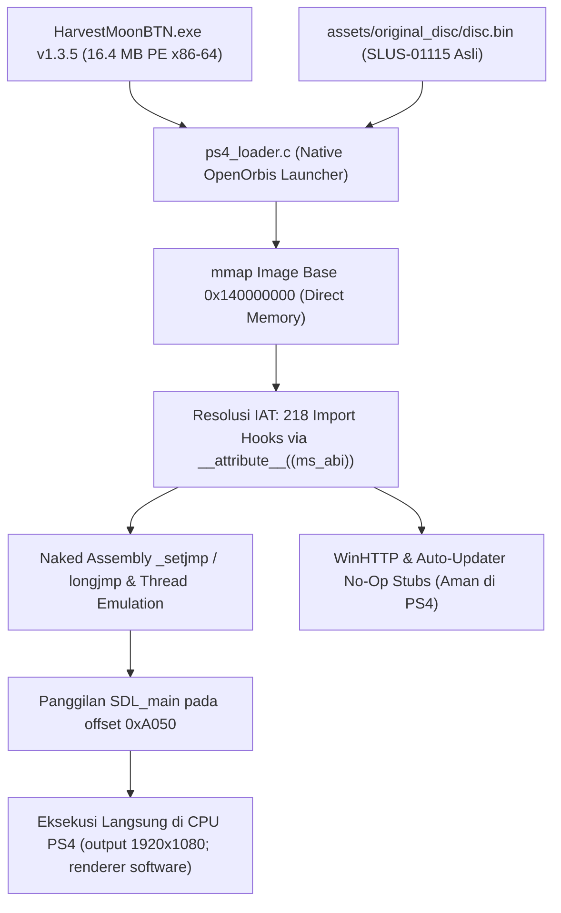

# Harvest Moon: Back to Nature — Dokumentasi PS4 Native Rebuild

> **ARSIP LEGACY — BUKAN JALUR PRODUKSI.** Walaupun judulnya menyebut rebuild, dokumen ini menjelaskan jalur PE loader/SDL lama. Rebuild aktif berada di `native/`.

> **Target Rilis:** PlayStation 4 (AMD Jaguar x86-64 Native)  
> **Versi Game:** Mod Penyu v1.3.5 (Bahasa Indonesia — Claire Route, Kucing, Kontes, Mancing)  
> **Arsitektur:** Direct x86-64 PE Native Image Loader (Tanpa Emulator PS1 Sony)  
> **Terakhir Diperbarui:** 15 November 2026  

---

## 🛠️ 1. Environment & Toolchain

| Komponen | Status | Lokasi / Keterangan |
| :--- | :---: | :--- |
| **OpenOrbis Toolchain** | ✅ Terpasang (v0.5.4) | `E:\PS4\OpenOrbis\OpenOrbis\PS4Toolchain\` |
| **Header PS4 & SDL2** | ✅ Tersedia | `.../PS4Toolchain/include/` & `.../include/SDL2/` |
| **Library Native PS4** | ✅ Tersedia | `libkernel.so`, `libSceVideoOut.so`, `libScePad.so`, `libSceAudioOut.so`, `libSceUserService.so` |
| **Library Native SDL2 PS4** | ✅ Dioptimasi | `build_ps4/libSDL2_optimized.a`; software renderer dan video backend dibangun ulang `-O3` dari source SDL-PS4 |
| **Signer & Packager** | ✅ Tersedia & Teruji | `create-fself.exe`, `orbis-pub-cmd.exe` (v3.87) |
| **LLVM / Clang** | ✅ Terpasang (v23.1.4) | `C:\Program Files\LLVM\bin\clang.exe` & `ld.lld.exe` |
| **Node.js Runtime** | ✅ Terpasang | Mesin analisis IAT, generator loader, dan auto-updater |

---

## 📺 2. Konfigurasi Display & Video (FullHD 1080p 16:9 Widescreen)

Game dikonfigurasi agar berjalan pas pada layar TV modern beresolusi tinggi tanpa distorsi (tanpa gambar gepeng):

| Parameter | Pengaturan | Implementasi Teknis |
| :--- | :--- | :--- |
| **Target Resolusi** | **FullHD (1920 × 1080)** | `SDL_RenderSetLogicalSize(renderer, 1920, 1080)` & `SDL_CreateWindow(..., 1920, 1080, SDL_WINDOW_FULLSCREEN)` |
| **Rasio Aspek** | **16:9 Widescreen (`widescreen=1`)** | Menambahkan `0x35` (53 pixel PS1 per sisi) ke viewport 3D kamera untuk true 16:9 FOV |
| **Internal Scale** | **`resolution=1`** | Profil v2 Native (426×240 widescreen) untuk mengurangi source pixels 9× dari scale 3; instalasi lama dimigrasikan satu kali |
| **Texture Filter** | `SDL_HINT_RENDER_SCALE_QUALITY = "nearest"`, `smooth=0` | Menghindari biaya bilinear scaling pada renderer software |
| **Frame Present** | Flip/vblank backend PS4 | Tidak ada delay tambahan; FPS serta biaya `update/copy/present/other` dicatat setiap 5 detik |

> [!IMPORTANT]
> OpenOrbis pada build ini hanya menyediakan renderer software. Target output tetap 1920×1080, tetapi jangan menganggap 60 FPS stabil sebelum hasil log perangkat membuktikannya.

---

## 💾 3. Sistem Simpanan & Kompatibilitas Memory Card PS1

Porting native PS4 ini menggunakan format **Raw PS1 Memory Card Standar (128 KB / 131.072 byte)** dengan signature header `MC`:

| Format Sumber | Emulator / Asal | Perlu Konversi? | Cara Pakai |
| :--- | :--- | :---: | :--- |
| **`.mcr` / `.mcd`** | ePSXe, DuckStation, PCSX, Mednafen | ❌ **Tidak** (100% Identik) | Cukup ganti nama (rename) menjadi `card1.mcd`. |
| **`.srm`** | RetroArch (Beetle PSX, PCSX-ReARMed) | ❌ **Tidak** (100% Identik) | Ganti ekstensi file dari `.srm` ke `.mcd`. |
| **`.gme`** | DexDrive | ⚠️ **Header Strip** | Potong 3.904 byte header DexDrive di awal file. |
| **`.psv`** | PlayStation 3 Virtual Memory Card | ⚠️ **Ekspor** | Ekspor ke `.mcr` menggunakan tool *MemcardRex*. |
| **Save PS4 Emulator** | fPKG PS1 Classic bawaan PS4 | ⚠️ **Ekspor** | Ekspor save data via homebrew *Apollo Save Tool PS4*. |

### Lokasi File Simpanan di PS4:
Karena partisi instalasi (`/app0/`) berstatus **Read-Only (PFS)**, loader menggunakan sistem **Dynamic Redirection ke `/data/`**:
- **Folder Simpanan:** `/data/HarvestMoonBTN/saves/`
- **Slot 1:** `/data/HarvestMoonBTN/saves/card1.mcd`
- **Slot 2:** `/data/HarvestMoonBTN/saves/card2.mcd`
- **Konfigurasi:** `/data/HarvestMoonBTN/settings.ini`

> [!TIP]
> Folder `/data/` di PS4 dapat diakses bebas kapan saja menggunakan **FTP (GoldHEN FTP)** atau **PS4-Xplorer**. Save game tidak akan terhapus saat memasang PKG update baru!

---

## 🎮 4. Pemetaan DualShock 4 Controller (DS4 Native)

OpenOrbis `libSDL2.a` membaca DualShock 4 secara langsung via `libScePad`:

| Tombol DualShock 4 | Tombol PS1 Game | Aksi Dalam Game |
| :--- | :---: | :--- |
| **Cross (X)** | Cross (X) | Konfirmasi / Bicara / Gunakan Alat |
| **Circle (O)** | Circle (O) | Batal / Berlari / Masukkan ke Tas |
| **Square (Kotak)** | Square ([ ]) | Bersiul (Panggil Kuda & Anjing) |
| **Triangle (Segitiga)** | Triangle (/\) | Buka Ransel / Status Peternakan |
| **D-Pad / Left Stick** | D-Pad / Analog | Bergerak 8 Arah |
| **L1 / R1** | L1 / R1 | Rotasi Kamera / Ganti Perkakas Cepat |
| **Options / Start** | Start | Pause Menu |
| **Touchpad Click** | Select | Buka Peta Desa Mineral Town |
| **L3 / R3** | Host key F1 | Buka host/cheat menu |

Circle/O hanya menghasilkan tombol controller B dan tidak menyintesis Escape/F1. L3/R3 menyintesis F1 melalui event controller 7/8 atau fallback joystick 11/12. Tombol lainnya tetap diteruskan memakai pemetaan PlayStation/game yang sudah ada.

> [!NOTE]
> Database mapping pihak ketiga (`gamecontrollerdb.txt`) sengaja dinonaktifkan di `gen_loader.js` agar tidak menimpa profil native DualShock 4 PS4.

---

## 🚀 5. Arsitektur Native Execution (v1.3.5 Update)

CPU PlayStation 4 adalah **AMD Jaguar x86-64 (AMD64)** dan `HarvestMoonBTN.exe` versi 1.3.5 merupakan biner x86-64 murni dari GCC MinGW:



### Rincian 220 Fungsi IAT yang Di-hook:
- **SDL2 (44 fungsi):** Video, accelerated renderer, audio output, DualShock 4 events, dynamic VSync.
- **KERNEL32 (45 fungsi):** Heap, memory virtual, file attributes, TLS, multithreading (`CreateThread`, `WaitForSingleObject`).
- **MSVCRT (102 fungsi):** File I/O (`fopen`, `fread`, `fwrite`), string operations, naked asm `_setjmp`/`longjmp`, math, sync.
- **WINHTTP (11 fungsi):** No-op stubs aman agar background thread updater keluar tanpa menyebabkan crash atau network error.
- **SHELL32 & USER32 (6 fungsi):** Command line parser, message box blocker, dan file dialog auto-responder.

---

## 📦 6. Struktur Paket & Hasil Build

### File Staging (`E:\PS4\hmbtn\pkg_staging\`)
```text
pkg_staging/
├── eboot.bin                       # 2.26 MB (Signed PS4 FSELF Executable)
├── HarvestMoonBTN.exe              # 16.4 MB (Engine Game v1.3.5)
├── disc.bin                        # 213.9 MB (Disc Asli SLUS-01115)
├── disc.cue                        # Track Index Cue File
├── settings.ini                    # Default settings (widescreen=1)
├── saves/                          # Template kartu memori kosong (card1 & card2)
└── sce_sys/
    ├── param.sfo                   # CUSA01117 / Content ID: UP9000-CUSA01117_00-HMBTNNATIVE00001
    ├── icon0.png                   # 512x512 PNG Icon
    └── pic0.png                    # 1920x1080 PNG Full HD Banner
```

### Paket Final fPKG yang Dihasilkan
- **Lokasi File:** `E:\PS4\hmbtn\releases\HarvestMoonBTN-PS4-Native.pkg`
- **Ukuran File:** `249,954,304 bytes`
- **SHA-256:** `553D9B768D8000DB736BE5865B7FB604B158A48BB1FA0B8BE5C01B4BFDD2ABFC`
- **FTP PS4:** `ftp://10.0.0.90:2121/data/pkg/HarvestMoonBTN-PS4-Native.pkg` (upload build terbaru dan ukuran remote `249,954,304` byte terverifikasi)
- **Title ID:** `CUSA01117`
- **Content ID:** `UP9000-CUSA01117_00-HMBTNNATIVE00001`
- **Tipe Paket:** Application Package (gd - Game Digital)
- **Kompatibilitas Firmware:** PlayStation 4 Firmware 5.05 hingga 11.00+ (GoldHEN / Mira)
- **Proteksi Tampilan:** 1080p 16:9 dikunci secara stabil melalui layer SDL2 dan settings.ini tanpa merusak kode mesin game. Cheat, Save State, Volume, dan Pengaturan Bahasa tetap aktif.

### Bahasa dan Validasi Setelah Instalasi

- Menu menyimpan `id` atau `en` di `/data/HarvestMoonBTN/data/lang.txt`; path lama `/data/HarvestMoonBTN/lang.txt` dimigrasikan.
- Loader meneruskan bahasa melalui `HMBTN_LANG`, `--lang`, dan `__getmainargs`. Restart game diperlukan setelah mengganti bahasa.
- Bundle patch EN/ID tertanam di `HarvestMoonBTN.exe`. Konsistensi semua dialog masih harus diuji karena paket membawa disc USA mentah.
- Validasi perangkat: O hanya Cancel/Back; L3/R3 membuka menu; ganti bahasa lalu restart; cek `loader.log` untuk bahasa terpilih dan sampel FPS 5 detik.

---

## 📋 7. Checklist Eksekusi Porting

- [x] **Fase 1:** Setup OpenOrbis Toolchain v0.5.4 & Clang LLVM-23 target FreeBSD 12 ELF.
- [x] **Fase 2:** Analisis PE AMD64 dan identifikasi 175 fungsi IAT awal (v1.3.0).
- [x] **Fase 3:** Transisi ke format v1.3.5 (analisis 218 import, deteksi offset `SDL_main` di `0x9950`).
- [x] **Fase 4:** Implementasi assembly naked `_setjmp`/`longjmp` dan Win32 thread emulation (`CreateThread`).
- [x] **Fase 5:** Penyesuaian disc mapping SLUS-01115 (`disc.bin`/`disc.cue`) dan penonaktifan mapping kontroler pihak ketiga (DualShock 4 exclusive).
- [x] **Fase 6:** Pembuatan sistem auto-update 1-klik (`check_update.bat` & `check_update.js`) dengan verifikasi sha256 dan rollback backup otomatis.
- [x] **Fase 7:** Kompilasi native, linking FSELF, perakitan fPKG final, dan upload FTP terverifikasi.
- [ ] **Fase 8:** Validasi runtime PS4 untuk FPS, mapping Circle/L3/R3, persistensi bahasa, dan konsistensi dialog gameplay.
