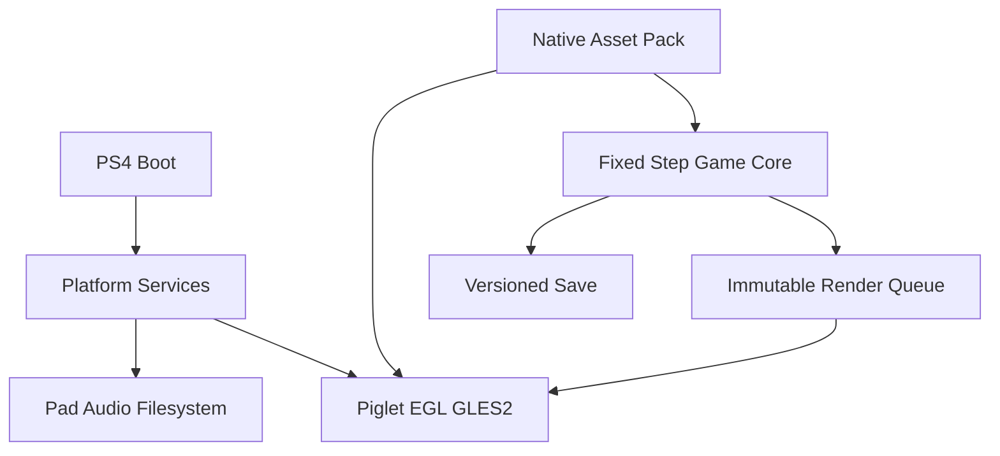

# Rebuild Native PS4 untuk 1080p 50 sampai 60 FPS

## Keputusan

Mulai 16 November 2026, jalur produksi tidak lagi memakai PE loader, emulator, atau renderer software SDL. Log perangkat pada jalur lama menunjukkan beban game dan emulasi sekitar 90–150 ms serta present software sekitar 22–38 ms. Batas 60 FPS hanya 16,67 ms dan batas 50 FPS adalah 20 ms, sehingga penurunan resolusi tidak menyelesaikan akar masalah.

Game dibangun kembali sebagai engine native. Loader lama tetap disimpan sebagai referensi perilaku dan reverse engineering, bukan sebagai runtime produksi.

## Kontrak produk

- Output fisik selalu 1920×1080.
- Render target memakai aspect fit 16:9 penuh.
- Tidak ada dynamic resolution atau penurunan resolusi tersembunyi.
- Target steady-state 60 FPS; minimum 50 FPS pada scene berat.
- Core gameplay deterministik dan terpisah dari renderer.
- Circle adalah Cancel atau Back.
- L3 atau R3 sendiri tetap tersedia untuk gameplay.
- Chord L3+R3 menjadi trigger cheat menu dengan edge latch.
- Bahasa Indonesia dan Inggris memakai string ID yang sama pada seluruh UI.
- Tidak ada decode aset, I/O disc, kompilasi shader, atau alokasi heap pada render loop steady-state.
- Kegagalan GPU harus dicatat dan berhenti dengan aman; software fallback tidak boleh aktif diam-diam.

Pada milestone GPU saat ini, chord L3+R3 baru men-toggle indikator diagnostik. Cheat menu, fungsi Circle, dan lokalisasi lengkap merupakan kontrak vertical slice dan belum menjadi fitur gameplay probe.

## Arsitektur



Struktur aktif:

```text
native/
├── include/hmbtn/       # Kontrak portable core
├── src/                 # Core, input, dan pixel helpers
├── platform/ps4/        # Piglet, scePad, telemetry, dan logging
└── packaging/           # Metadata fPKG

tests/
├── native_core_exports.c      # Harness DLL freestanding yang dijalankan
├── run_native_tests.ps1       # Unit test core aktif
└── native_ps4_probe.test.js   # Architecture gate PS4
```

`tests/native_core_test.c` adalah spesifikasi C tambahan, tetapi harness Windows aktif memakai `native_core_exports.c`. Coverage 80 persen belum diukur dan tetap menjadi pekerjaan milestone core.

## Backend GPU

Backend produksi menggunakan Piglet/EGL/OpenGL ES 2.0. Probe saat ini:

- membuat render target dan viewport 1920×1080;
- memakai atlas RGBA 1024×1024 dengan alpha;
- memakai nearest filtering dan alpha blending;
- menyusun 2.048 sprite dalam satu batch dan satu draw call;
- membaca DualShock 4 langsung melalui `scePad`;
- menyimpan log di `/data/HarvestMoonBTNNative/perf.log`;
- tidak memanggil SDL renderer.

Grid diagnostik berukuran 1920×960 di dalam render target 1920×1080. Ini membuktikan target 16:9, tetapi belum membuktikan bahwa layout dunia dan kamera game selesai.

Probe aktif meminta `eglSwapInterval(0)`. Karena itu hasil sekarang adalah gate throughput GPU uncapped atau default compositor, bukan bukti frame pacing yang dikunci ke satu present per vblank. Gate pacing 59,94/60 Hz harus diuji terpisah setelah sinkronisasi vblank eksplisit tersedia.

## Anggaran frame

| Komponen | Target p95 |
|---|---:|
| Input dan platform | 0,25 ms |
| Simulasi gameplay | 2,00 ms |
| Event AI dan collision | 1,50 ms |
| Animasi dan culling | 1,00 ms |
| Render queue | 1,00 ms |
| GPU sprite dan UI | 4,00–6,00 ms |
| Audio | 0,50 ms |
| Present | Maksimum 4,00 ms |
| Total p95 | Maksimum 16,67 ms |
| Total p99 | Maksimum 20,00 ms |

Gate throughput perangkat saat ini:

- `fps >= 59`;
- `p95 <= 16667 us`;
- `p99 <= 20000 us`;
- `1% low >= 50 FPS`;
- `over20ms` mendekati nol setelah warm-up;
- tidak crash, tidak leak, dan tidak ada software fallback.

Gate paced 60 Hz berikutnya harus membuktikan interval present stabil sekitar 16,67 ms, satu flip per refresh, dan missed-vblank aktual. Counter `missed` probe saat ini bukan counter driver.

## Cara membaca telemetri

Probe mengukur interval start-to-start antar-frame. Window statistik berisi 300 interval.

- `avg`: rata-rata interval;
- `p95`: sampel urut indeks 284;
- `p99`: sampel urut indeks 296;
- `max`: interval terburuk;
- `fps`: satu juta dibagi `avg` dalam mikrodetik;
- `1%low`: FPS dari rata-rata tiga interval terlambat;
- `missed`: jumlah interval di atas 16.667 us, bukan counter missed-vblank dari driver;
- `over20ms`: jumlah interval yang melanggar minimum 50 FPS.

Contoh format:

```text
[NATIVE PERF] 1080p sprites=2048 avg=...us p95=...us p99=...us max=...us fps=... 1%low=... missed=.../300 over20ms=.../300
```

## Sumber aset

- `disc_extracted/SLUS_011.15`: executable/data referensi PS1;
- `disc_extracted/A_FILE.BIN`: archive konten 133.935.104 byte;
- `disc_extracted/A_FILE.HDT`: 33 offset untuk 32 bagian archive;
- `disc_extracted/STR/*.XA`: empat stream audio;
- `hd_pack_temp/SLUS-01115/replacements`: 922 tekstur HD;
- `archive/legacy_decompiled`: referensi dekompilasi, bukan source produksi.

Asset pipeline yang direncanakan adalah disc milik pengguna → parser tervalidasi → manifest/checksum → atlas dan pack native → streaming/LRU per zona. Parser wajib memvalidasi offset, panjang, overflow, overlap, dan ukuran alokasi.

## Roadmap

1. **GPU proof of concept** — build selesai; validasi perangkat sedang berjalan.
2. **Asset importer** — parser A_FILE/HDT, map, sprite, palette, collision, script, dan audio.
3. **Vertical slice** — satu area kebun, player, kamera 16:9, collision, NPC/dialog, crop, inventory, audio, save, ID/EN, dan cheat menu.
4. **Paritas sistem** — waktu, cuaca, stamina, tool, crop, ternak, NPC schedule, toko, festival, event, cutscene, dan ending.
5. **Konten HD dan hardening** — 922 tekstur, seluruh map/dialog/audio, replay parity, save migration, soak test, serta performance regression.

Game lengkap tidak diklaim tersedia sebelum semua milestone paritas selesai.

## Build lokal

```powershell
powershell -NoProfile -ExecutionPolicy Bypass -File tests\run_native_tests.ps1
node tests\native_ps4_probe.test.js
cmd /c build_native_ps4.bat
```

Path toolchain hardcoded berada di bagian awal `build_native_ps4.bat`. Pengguna dengan instalasi berbeda harus mengubah `ROOT`, `TOOLCHAIN`, `LLVM`, dan `FAKE_PKG`.

Packaging memakai `create-gp4.exe` dan `PkgTool.Core.exe`. Environment `DOTNET_ROLL_FORWARD=Major` diperlukan karena tool meminta runtime .NET lama sedangkan host memiliki runtime baru.

## Dokumen legacy

Dokumen yang membahas PE offset, IAT hook, `resolution=1`, SDL software, CUSA01117, atau memory card loader hanya berlaku untuk jalur lama. Jika ada konflik, source pada `native/`, dokumen ini, runbook probe, dan status rebuild menjadi acuan aktif.
